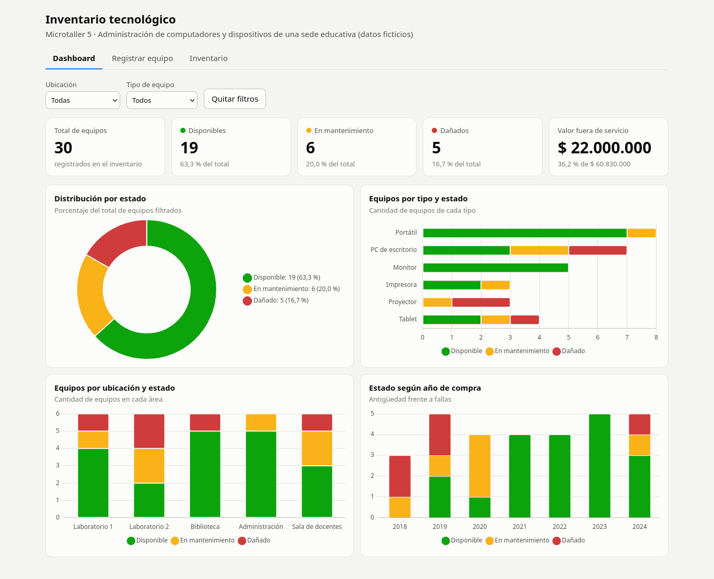

# Inventario tecnológico

Microtaller 5 · Inteligencia de Negocios · Universidad Manuela Beltrán
Nicolás Esteban Rodríguez Calderón

Sistema para administrar los computadores y dispositivos tecnológicos de una sede educativa (datos ficticios).

**Aplicación en línea:** https://nicolas0pm.github.io/inventario-tecnologico/

**Video explicativo:** https://youtu.be/FVNg7C28K9w

## Contenido

| Archivo | Descripción |
|---|---|
| `index.html` | Aplicación web: formulario de registro, inventario y dashboard interactivo (HTML, CSS, JavaScript y Chart.js) |
| `base_datos_inventario.xlsx` | Base de datos de 30 equipos y dashboard con fórmulas y gráficos |
| `datos_inventario.json` | Los mismos 30 registros en formato JSON |
| `captura_dashboard.png` | Captura del dashboard |

## Indicadores del dashboard

- Total de equipos
- Equipos disponibles y porcentaje
- Equipos en mantenimiento y porcentaje
- Equipos dañados y porcentaje
- Valor de los equipos fuera de servicio

Gráficos: distribución por estado, equipos por tipo y estado, equipos por ubicación y estado, y estado según año de compra. Se puede filtrar por ubicación y tipo de equipo.

## Uso

Abrir el enlace de la aplicación o descargar `index.html` y abrirlo en el navegador; no requiere instalación ni internet. Los equipos registrados se guardan en el navegador; el botón "Restaurar datos de ejemplo" vuelve a los 30 registros originales.

